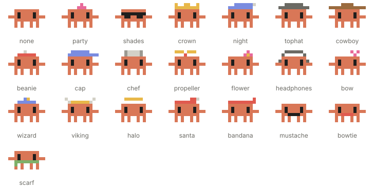

# Lines Tracker for Claude Code

**Count the lines of code Claude writes for you, with Clawd keeping you company while it does.**

Lines Tracker is a mod for Claude Code (the terminal `claude` command, or the Code tab of the Claude desktop app). It adds a band above the prompt box with today's lines, this chat's lines and your all-time total, plus a side pane with the details. It uses **no model tokens**: it watches Claude's Write and Edit actions and counts the lines itself, on your computer. Blank lines are never counted, and every total is shown two ways: code only, and with comments.

If you want to see how much Claude actually writes for you each day, or just like a small pixel crab cheering you on, this is for you.



*Example band with sample numbers. The pictures in this README are animated and follow your light or dark setting, as the mod does.*

---

## Contents

- [What you get](#what-you-get)
- [Requirements](#requirements)
- [Install](#install)
- [Using it](#using-it)
- [Examples](#examples)
- [How counting works](#how-counting-works)
- [What it reads and writes](#what-it-reads-and-writes)
- [Troubleshooting](#troubleshooting)
- [Update or uninstall](#update-or-uninstall)
- [For developers](#for-developers)
- [Status and credits](#status-and-credits)

---

## What you get

**A band above the prompt box** with today's lines (every open chat added up), this chat's lines, the all-time total, and Clawd, a small pixel crab.

- **Clawd** blinks, types while Claude works, hops when lines are written, and does tricks when idle (wave, dance, spin, peek, sneeze and more). He wears a different outfit each day.
- **The stage** beside him plays a new little scene every 30 seconds: idle ones (a bug chase, a butterfly, juggling, a coffee break, sweeping, a paper airplane...) and working ones (code rain, an editor typing, a build bar, a hamster wheel...). The day's first chat opens with a wake-up scene, and after 10 pm a night scene.
- **The pile** at the stage's right end is today's work: a block per 100 code lines, a gold column per 1,000.
- After each write a green **+N** shows how many lines just landed; every 1,000 lifetime lines sets off confetti.

A busy day, with gold columns on the pile:



A few of the stage's scenes:

| | |
|---|---|
|  |  |
|  |  |
|  |  |

Clawd's wardrobe (on "auto" he picks one a day, some days none, and a nightcap after 10 pm):



**A side pane** with the details: Clawd's level, this chat's split of code, comments and blank lines, two rings of code lines by model (today and all time), the last 4 weeks as a heat strip with your streak, the chats writing right now, file types, the biggest files, and badges. It can sit on the app's own background or a color of your choice, and every section can be switched off.

| App background | Night background |
|---|---|
|  |  |

**Other band designs**, if you prefer them (`/linecount style <name>`):


**Two or more computers (optional):** point each computer at a folder you already sync, and the pane shows each computer in its own color plus a combined count. See [How counting works](#how-counting-works).

**Cloud sessions:** lines written by Claude Code cloud sessions (claude.ai/code, the mobile app) show up as one more computer, **Cloud**, read from the commits those sessions leave in your git repos. See [Cloud sessions](#cloud-sessions).

---

## Requirements

- **Claude Code**, either the terminal `claude` command or the Code tab of the Claude desktop app, on macOS, Windows or Linux.
- **A Claude Code version that supports mods.** Mods are an early-access feature, so a future update may change how they work.
- **macOS** only for the optional two-computer count (it reads the computer's name and model with macOS commands).
- **git**, only for the "Hard" install below.

---

## Install

Pick one of three ways. Simple and Medium do the same thing; Hard is for changing the code.

### Simple: inside Claude (no terminal)

In a Claude Code chat, type `/plugin`. Add the marketplace `Ben-Diehlci/Claude-CodedLinesTracker`, then install `lines-tracker` from it.

In the desktop app you can also click **+** next to the prompt box, then **Plugins**, **Add marketplace** with `Ben-Diehlci/Claude-CodedLinesTracker`, then **Add plugin**.

### Medium: two terminal commands

The repo is its own plugin marketplace. Run these in a terminal:

```bash
claude plugin marketplace add Ben-Diehlci/Claude-CodedLinesTracker
```

```bash
claude plugin install lines-tracker@claude-codedlinestracker --scope user
```

### Hard: from your own copy (to change the code)

You keep a copy of the code on your computer and Claude Code loads it from there, so your edits take effect after a reload.

1. Get the code:

   ```bash
   git clone https://github.com/Ben-Diehlci/Claude-CodedLinesTracker.git
   ```

2. Check that it is sound (this reads the mod the way Claude Code will, and runs its tests):

   ```bash
   cd Claude-CodedLinesTracker && claude plugin validate . && claude plugin test .
   ```

3. Either try it in one session only:

   ```bash
   claude --plugin-dir /full/path/to/Claude-CodedLinesTracker
   ```

   or install it for good from your copy (the folder is its own marketplace):

   ```bash
   claude plugin marketplace add /full/path/to/Claude-CodedLinesTracker
   ```

   ```bash
   claude plugin install lines-tracker@claude-codedlinestracker --scope user
   ```

After you edit a file, type `/reload-plugins` in a chat to pick up the change. Use either this or the marketplace install, not both.

### After installing

1. In any open Claude Code chat, type `/reload-plugins` (or start a new chat).
2. Send a message. The band shows up above the prompt after it, and `/linecount` opens the pane.
3. **Getting updates automatically:** type `/plugin`, open **Marketplaces**, pick `claude-codedlinestracker` and turn on **auto-update**. It's off by default for marketplaces that aren't Anthropic's. Without it, see [Update or uninstall](#update-or-uninstall).

---

## Using it

Everything is under one slash command, `/linecount`:

| Command | What it does |
|---|---|
| `/linecount` | Opens the pane and shows a one-line summary |
| `/linecount status on\|off` | The band above the prompt |
| `/linecount pane on\|off` | Open the pane when a chat starts |
| `/linecount mascot on\|off` | Clawd (and the little face on the working spinner) |
| `/linecount style auto\|card\|classic\|arcade\|compact` | The band's design ("auto" is card, or compact when the window is narrow) |
| `/linecount outfit auto\|none\|<name>` | Clawd's outfit: "auto" changes daily, or pick one (crown, tophat, cowboy, wizard, viking, ...) |
| `/linecount background <name>` | The pane's background: none (the app's own), paper, sand, blush, slate or night |
| `/linecount section <name> on\|off` | Show or hide a pane section: header, numbers, rings, heat, sessions, languages, files, badges |
| `/linecount sync <folder>\|off` | Count across computers using a synced folder (`/linecount sync` alone shows the folder in use) |
| `/linecount count this\|both` | Show only this computer's numbers, or add all computers up |
| `/linecount computers` | List the computers in the count, with their colors and when each was last seen |
| `/linecount cloud` | Shows the cloud-session count: the mode, how many repos it reads, lines today and all time |
| `/linecount cloud all\|picked\|off` | Which repos are read for cloud lines: every one found (the default), only the ones you added, or none |
| `/linecount cloud add\|remove <repo>` | Add a repo to the picked list, or take one off it |
| `/linecount cloud scan` | Look for new cloud commits now instead of within 5 minutes |
| `/linecount reset` | Zeroes this chat's counts (today and all-time totals stay) |

Most of these are also buttons and pickers at the bottom of the pane (behind a Settings button when the pane has a background color).

---

## Examples

**"How much has Claude written today?"**
The band's first number is today's code lines across every open chat. Run `/linecount` for the split of code, comments and blank lines.

**"Which model wrote most of it?"**
Open the pane: the two rings show code lines by model, today and all time.

**"The band is too wide for my window."**
Run `/linecount style compact`, or leave it on `auto`, which switches to compact when the window is narrow.

**"I only want the numbers, no crab."**
Run `/linecount mascot off`. The counting carries on as before.

**"I also use Claude Code on the web and on my phone."**
Nothing to set up: once those sessions' commits are on this computer (after a `git pull` or `git fetch`), the pane shows a **Cloud** row. `/linecount cloud` shows what was found.

**"Only count cloud work in my work repos."**
Run `/linecount cloud add ~/code/app` for each one, then `/linecount cloud picked`.

**"I use a laptop and a desktop."**
Set up the two-computer count below; `/linecount computers` then shows both, each in its own color.

---

## How counting works

- Only Claude's Write and Edit actions are counted; code made by shell commands is not.
- Blank lines are never counted. Comments are told apart by file type, which is a good guess rather than a perfect one.
- Counting starts when the mod is installed. Lines by model are known from 2026-11-03 on; older lines show as "earlier". A subagent's lines count under its chat's model.
- Totals live on each computer, in Claude Code's own plugin store.

### Two or more computers (optional)

By default each computer counts alone. To see each computer and a combined count, point every computer at one folder that something already syncs between them (Syncthing, iCloud Drive, Dropbox, OneDrive or a network share all work):

1. Make a folder inside a synced location, for example `~/Sync/lines-tracker` (with Syncthing: a folder inside one you already share, or a new shared folder).
2. On each computer run `/linecount sync ~/Sync/lines-tracker`, using the path that computer sees. The folder must exist, and it may sit at a different path on each computer.
3. Run `/linecount computers` to check. After the other computer has run it too, each shows up with its own color and the totals add up.

Each computer writes only its own small file there and reads the others. A computer never edits another's file, so the sync tool has nothing to conflict over. A computer that is off keeps its last numbers, shown with "last seen". `/linecount count both` (the default once a folder is set) adds them up; `/linecount count this` shows only this computer's numbers.

### Cloud sessions

A cloud session runs in a container that is gone when the session ends, so the mod never sees its Write and Edit actions. What the session leaves behind is commits, and each one ends with lines like these:

```
Co-Authored-By: Claude Opus 5.5 <noreply@anthropic.com>
Claude-Session: https://claude.ai/code/session_01...
```

Every 5 minutes one open chat asks git, on this computer, for commits carrying a `Claude-Session: https://claude.ai/code/session_` line that it has not read yet. It counts their added lines with the same rules as everything else and shows them as a computer called **Cloud**. The commit's time gives the day and hour, and the `Co-Authored-By` line gives the model for the rings. With `/linecount count this` the Cloud row is listed but not added in.

Which repos are read (`/linecount cloud all|picked|off`):

- **all** (the default): every repo below your home folder, searched up to 5 folders deep once an hour; every repo a chat ran in; and any you added. Hidden folders and ones like `node_modules`, `Library` and `Downloads` are skipped.
- **picked:** only the repos you added with `/linecount cloud add <repo>`.
- **off:** cloud lines are left out.

What to know:

- **Only commits on this computer count.** The mod never fetches, so a cloud session's work shows up once you `git pull` or `git fetch` that repo here. All branches are read, including remote-tracking ones.
- **It counts the commit, not each edit.** Code Claude rewrote within a session counts once, as committed. Lines you added by hand to the same commit count too.
- **Nothing is counted twice:** the same change found again (in a second clone, rebased or cherry-picked) counts once. A GitHub squash merge is skipped while the commits it squashed are still around, and counted once they are gone.
- **Lock files** (`package-lock.json`, `yarn.lock`, `Cargo.lock`, `go.sum` and the like) and minified files are left out, since tools write them, not Claude.
- Lines from commits already counted stay counted, even if that repo is later deleted. In **picked** mode only the picked repos' commits are shown.
- With two-computer counting on, each computer shows the cloud commits in its own repos; they are not written to the synced folder.

---

## What it reads and writes

- **Reads:** what Claude passes to its Write and Edit actions (the file's name and the lines written), to count them. With two-computer counting on, the other computers' totals files in your synced folder. With cloud counting on (the default), the folder names below your home folder (to find repos) and, through `git log`, the commits there that carry a `Claude-Session:` line.
- **Writes:**
  - the counts, by day, model, file type and file, in Claude Code's plugin store on your computer
  - your `/linecount` settings, in the same store
  - for each cloud commit counted: its time, session id, model and line counts (no file names or code), in the same store
  - with two-computer counting on, `totals-<computer name>.json` in your synced folder: line counts and the computer's model name (such as "MacBook Pro"), no file names or code
- **Runs:** `scutil --get LocalHostName` and `system_profiler SPHardwareDataType` (macOS) to name the computer, when two-computer counting is on or cloud lines were found. With cloud counting on, `git log` and `git rev-parse` in your repos (read-only; git runs with repo hooks off).
- **Never:** sends anything over the network (not even `git fetch`), asks a model anything, or changes your files. Your sync tool, not the mod, moves the totals file.

---

## Troubleshooting

| You see | Fix |
| --- | --- |
| No band above the prompt | Send a message: the band appears after the next one. If it still doesn't, type `/reload-plugins`, run `/linecount status on`, and check that `claude plugin list` shows `lines-tracker` as enabled. |
| No pane | Type `/linecount`. To open it in every new chat, run `/linecount pane on`. |
| Lines I know were written aren't counted | Only Write and Edit actions count. Files made by shell commands (for example a script that writes a file) are not. |
| Lines by model say "earlier" | Those lines were counted before 2026-11-03, when model tracking began. |
| The other computer doesn't show up | Run `/linecount sync <folder>` on that computer too, check the folder exists there and your sync tool is running, then `/linecount computers`. |
| The band is cut off | Use `/linecount style compact`, or `auto`. |
| No Cloud row, or cloud lines missing | Pull or fetch the repo the cloud session pushed to, then `/linecount cloud scan`. Check `/linecount cloud` says `all`, or that the repo is in the picked list. A repo outside your home folder, or deeper than 5 folders, needs `/linecount cloud add <repo>`. |
| macOS asks whether Claude may open a folder | The cloud repo search lists folders below your home folder. Allow it, or use `/linecount cloud picked` with the repos you want. |

---

## Update or uninstall

**Update (Simple or Medium install):** with auto-update on, new versions arrive by themselves. Otherwise run these, then `/reload-plugins` or start a new chat:

```bash
claude plugin marketplace update claude-codedlinestracker
```

```bash
claude plugin update lines-tracker@claude-codedlinestracker
```

New versions are listed on the [releases page](https://github.com/Ben-Diehlci/Claude-CodedLinesTracker/releases).

**Update (Hard install):** run `git pull` in your copy, then `/reload-plugins`.

**Uninstall:** run `claude plugin uninstall lines-tracker@claude-codedlinestracker`, then `/reload-plugins` or start a new chat. If you set up two-computer counting, you can then delete that computer's `totals-<computer name>.json` from the synced folder.

---

## For developers

| File | What it holds |
| --- | --- |
| `.claude-plugin/plugin.json` | Name, version and description |
| `.claude-plugin/marketplace.json` | Makes the repo its own marketplace |
| `hooks/register.tsx` | Wires it up: events, the store, timers, two-computer sync |
| `hooks/count.ts`, `hooks/model.ts` | Count the lines and work out the numbers; designs only draw them |
| `hooks/peers.ts` | Reads and adds up the other computers' totals |
| `hooks/cloud.ts` | Reads cloud sessions' commits out of `git log` and adds them up as the Cloud computer |
| `hooks/styles/` | The band designs, one file each. The desktop band is one SVG, which the app caps at 128 KB. |
| `hooks/clawd.ts` | Clawd: sprite, outfits, tricks |
| `hooks/stage.ts`, `hooks/scenes.ts` | The stage and its scenes |
| `hooks/panesvg.ts`, `hooks/panes.tsx` | The desktop pane and the terminal pane |
| `design/` | Design mockups. `design/preview/preview.sh` draws every design into one page to compare; `design/preview/export.sh` remakes the pictures in this README. |
| `scripts/release.sh` | Publishes a new version |

**Releasing an update:** installed copies only see a change once the version in `.claude-plugin/plugin.json` goes up, so pushing without a release reaches nobody else. Commit your changes, then run (with the new version):

```bash
./scripts/release.sh 0.2.1
```

It checks and tests the mod, writes the version into `plugin.json`, tags it `v0.2.1`, pushes, and makes a GitHub release listing the commits since the last one. Add `--dry-run` to only check. Use the last number for fixes (0.2.0 to 0.2.1), the middle one for new features (0.2.1 to 0.3.0).

**Checks before committing:**

```bash
claude plugin validate .
```

```bash
claude plugin test .
```

---

## Status and credits

- **Version 0.2.0.** In daily use by its author. Mods are early access in Claude Code, so expect occasional breakage after updates.
- **License:** [MIT](LICENSE). Use, change and share it freely; keep the copyright notice.
- **Clawd** is Anthropic's Claude Code mascot. The pixel drawings here are an unofficial fan-made version. This project isn't affiliated with or endorsed by Anthropic.
- Sister mod: [Session Following](https://github.com/Ben-Diehlci/Claude-Session-Following), a panel that shows every Claude Code session at a glance.
